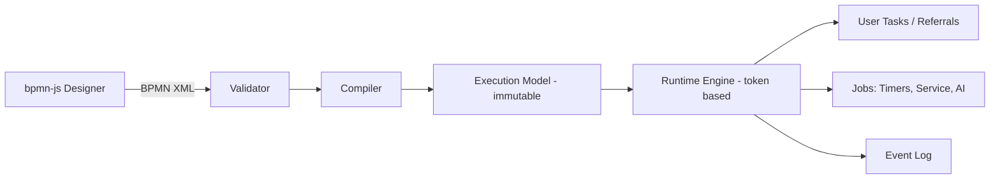

# Ravand

**Multi-tenant workflow and office-automation platform with a visual BPMN designer and built-in AI.**

Ravand lets organizations model their own approval and administrative processes visually, attach dynamic forms to them, and run them with a reliable, auditable engine. It is built for government offices and commercial companies, with first-class support for RTL/LTR layouts and both Gregorian and Jalali (Shamsi) calendars.

> **Status: early development (design and foundation phase).** This README describes the target product and architecture. Items under [Roadmap](#roadmap) are checked only when they are implemented.

---

## Why Ravand

- **Process-first, not code-first.** Organizations design processes in a browser, publish a version, and run it. No redeploy needed.
- **Fast to adopt.** Ready-made process packs (starting with *Request & Approval*) deliver value on day one instead of asking customers to model everything from scratch.
- **Built for administrative reality.** Referral-based routing to positions (not only people), delegation, SLAs with working calendars, full audit trail.
- **Deployable your way.** Multi-tenant SaaS or single-tenant on-premise from the same codebase, for organizations that cannot move data out.
- **AI as a controlled capability.** AI is a task type and an authoring assistant, never an opaque part of the engine's decision logic.

## Key Capabilities

### Process design and execution
- Visual designer based on [bpmn.io](https://bpmn.io/) (bpmn-js)
- Versioned process definitions; published versions are immutable and running instances stay pinned to their version
- Token-based runtime engine with persistence and crash-safe resume
- Supported BPMN subset (MVP): Start/End events, Timer events, User Tasks, Service Tasks, AI Tasks, Exclusive and Parallel gateways, conditional sequence flows
- Strict publish-time validation: unsupported BPMN elements are rejected with clear messages

### Forms and tasks
- Schema-driven dynamic forms with versioning
- Personal inbox (worktray), claim/complete/return/refer actions
- Assignment by user, position, or role; delegation and substitution
- SLA, reminders, and escalation based on tenant working calendars

### AI
- **Process Copilot:** generate a draft process from a natural-language description (always validated and reviewed before publishing)
- **AI Task:** classification, summarization, field extraction, and draft replies as a step inside a process
- Provider abstraction (cloud or local models), structured outputs, PII redaction, human-in-the-loop, and a full AI invocation audit log

### Platform
- Multi-tenancy with row-level isolation
- Role- and privilege-based access for both menus and API endpoints
- JWT authentication with refresh-token rotation
- RTL/LTR UI, Persian and English localization, Gregorian and Jalali calendars
- Outbox pattern for reliable integration and background jobs

## Architecture

Ravand is a **modular monolith** following **Clean Architecture** and **Domain-Driven Design**, using **CQRS** at the application boundary. Modules communicate through contracts and integration events, which keeps them extractable into services later without paying microservice costs up front.



**Key decisions**

| Area | Decision |
|---|---|
| Definition format | BPMN XML is the design artifact; the engine executes a compiled, validated execution model |
| Engine | Pure domain service (state + event in, new state + commands out) for high testability |
| Consistency | One command, one aggregate, one transaction; optimistic concurrency via row versions |
| Integration | Transactional outbox, idempotent consumers |
| Multi-tenancy | `TenantId` everywhere, EF Core global query filters, SQL Server Row-Level Security as a second layer |
| Time | All timestamps stored as UTC `DateTimeOffset`; Jalali is a presentation concern only |
| Expressions | Sandboxed expression evaluator for conditions; no arbitrary script execution |

### Modules and database schemas

| Schema | Responsibility |
|---|---|
| `Security` | Users, roles, claims, logins, tokens (ASP.NET Core Identity) |
| `Org` | Organization units, positions, user positions, delegation |
| `Setting` | Menus, privileges, role and user privileges, settings, lookups |
| `Workflow` | Forms, workflow definitions and versions, instances, tokens, referrals, history, jobs |
| `Tenancy` | Tenants and tenant settings |
| `Ai` | Prompt templates, AI invocations |
| `Audit` / `Common` | Audit log, outbox/inbox, calendars and holidays |

## Tech Stack

| Layer | Technology |
|---|---|
| Backend | C#, .NET 10, ASP.NET Core |
| Architecture | Clean Architecture, DDD, CQRS (mediator pipeline with validation, logging, transaction, authorization, tenant behaviors) |
| Data | SQL Server, Entity Framework Core |
| Identity | ASP.NET Core Identity, JWT with refresh-token rotation |
| Frontend | Angular 22, TypeScript |
| Designer | bpmn-js (bpmn.io) |
| i18n | RTL/LTR, fa/en, Gregorian and Jalali calendars |
| Testing | Unit tests, integration tests with Testcontainers, architecture tests |
| DevOps | Docker, Docker Compose, CI/CD |

## Repository Structure

```text
ravand/
├── src/
│   ├── BuildingBlocks/     # Domain primitives, Result, Specification, Outbox, multi-tenancy
│   ├── Modules/
│   │   ├── Identity/       # Domain, Application, Infrastructure, Api per module
│   │   ├── Tenancy/
│   │   ├── Definitions/    # BPMN XML, versions, validator, compiler
│   │   ├── Runtime/        # Engine, instances, tokens, tasks, timers
│   │   ├── Forms/
│   │   ├── Notifications/
│   │   ├── Ai/
│   │   └── Audit/
│   └── Host/               # Composition root
├── clients/
│   └── web/                # Angular 22 application
├── tests/
├── docs/                   # Architecture, ADRs, ERD
├── deploy/                 # Docker Compose, CI/CD
└── README.md
```

Module boundaries are enforced in CI with architecture tests: modules never reference each other's domain directly.

## Getting Started

> The commands below are the intended developer workflow and will be finalized during Phase 0 (walking skeleton).

**Prerequisites**

- .NET 10 SDK
- Node.js (LTS) and the Angular CLI
- Docker (for SQL Server and supporting services)

```bash
# Start dependencies (SQL Server, etc.)
docker compose -f deploy/docker-compose.yml up -d

# Run the API
dotnet run --project src/Host

# Run the web client
cd clients/web
npm install
npm start
```

## Roadmap

- [ ] **Phase 0 - Foundation:** domain model, ADRs, walking skeleton (auth, tenancy, CI/CD, Docker)
- [ ] **Phase 0.5 - Spikes:** bpmn-js inside Angular (restricted palette, custom moddle extension, RTL labels); XML to validator to compiler to running a minimal process on the engine
- [ ] **Phase 1 - Engine core:** start/user task/decision/end, instances, tokens, task inbox, thorough tests
- [ ] **Phase 2 - Designer and forms:** form builder, visual designer, versioning
- [ ] **Phase 3 - Runtime features:** timers/SLA, parallel gateway, notifications, audit
- [ ] **Phase 4 - AI:** provider abstraction, Process Copilot, AI Task
- [ ] **Phase 5 - First process pack:** *Request & Approval* template, documentation, demo

**Deliberately out of scope for the first release:** full BPMN 2.0 (sub-processes, message/signal events, compensation, multi-instance), microservices and Kubernetes, template marketplace, white-labeling, native mobile apps.

## Documentation

Architecture decisions are recorded as ADRs in [`docs/adr`](docs/adr). Additional documents (ERD, execution model, security model) live under [`docs/`](docs/).

## Third-Party Notices

The designer is built on [bpmn-js](https://github.com/bpmn-io/bpmn-js). Its license permits commercial use but requires keeping the bpmn.io watermark visible in the diagram canvas. Review the license terms before distributing the product commercially.

## License

To be decided. Until a license is published, all rights are reserved.

## Author

**Kamran Tajerbashi** - Senior Software Engineer and Full-Stack Developer

- GitHub: [KTajerbashi](https://github.com/KTajerbashi)
- LinkedIn: [kamran-tajerbashi](https://www.linkedin.com/in/kamran-tajerbashi-208b19247)
